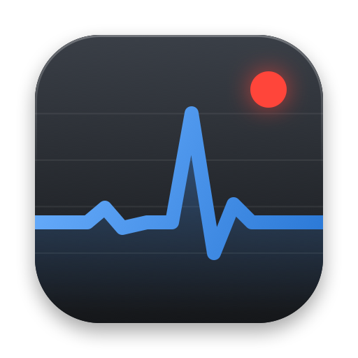

# MetalCap



[Polski](README.pl.md)

Frame time capture for games on macOS - the macOS counterpart of CapFrameX.

## Where the measurements come from

Frame data comes from the Metal Performance HUD, Apple's official performance tool built into macOS. MetalCap does not measure frames itself - it collects what the HUD reports, calculates the metrics and presents them.

## Features

- AVG, P1, 1% Low and 0.1% Low, calculated the same way as in CapFrameX
- Start and stop with a global shortcut, with a sound for each
- Frame time chart and system metrics: GPU load, CPU and GPU temperature, power, clocks, fan, memory
- Hardware, game window and Game Mode saved with every result
- Comments, renaming and sorting of results
- Export to JSON and CSV
- English and Polish

## Requirements

Mac with Apple silicon, macOS 14 or later (tested on macOS 27).

## Installation

Download `MetalCap-<version>.zip` from Releases and move `MetalCap.app` to Applications. The app is not notarized, so open it the first time with right-click - Open.

## Usage

1. Turn on Metal HUD with the switch in MetalCap, then restart the game and its launcher (Steam, CrossOver). Alternatively, start the game with "Launch game..." in MetalCap.
2. For games started from Steam or CrossOver, install the logging profile MetalCap offers at first launch (System Settings - General - Device Management). Without it macOS hides frame times of other apps.
3. In the game, press the shortcut (default Control-Option-R) to start and again to stop. The Metal HUD must stay visible.
4. The result appears in the list. Changes to the overlay settings take effect after the game is restarted.

## Metrics

- AVG - number of frames divided by the total time.
- P1, P5, median and other percentiles - R-8 percentiles of the frame rate, as in CapFrameX.
- 1% Low - either the mean of the slowest 1% of frames (Average) or the frame at which the slowest frames add up to 1% of the time (Integral, as in MSI Afterburner); chosen in settings.
- CPU power is an estimate from per-cluster power histograms, because macOS does not expose the CPU energy counter.

## Building

```sh
swift test             # unit tests
Scripts/e2e.sh         # end-to-end tests, need an unlocked Mac with the display on
Scripts/make-app.sh    # builds build/MetalCap.app
```

## License

MIT - see [LICENSE](LICENSE).
