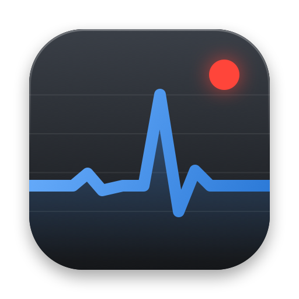

# MetalCap



[English](README.md)

Pomiar czasów klatek w grach na macOS - odpowiednik CapFrameX dla Maca.

## Skąd pochodzą pomiary

Dane o klatkach pochodzą z Metal Performance HUD, oficjalnego narzędzia Apple wbudowanego w macOS. MetalCap nie mierzy klatek sam - zbiera to, co raportuje HUD, liczy z tego metryki i je pokazuje.

## Funkcje

- AVG, P1, 1% Low i 0.1% Low (Average albo Integral) nazwane i liczone tak samo jak w CapFrameX
- Start i stop globalnym skrótem, z dźwiękiem
- Wykres czasu klatki i metryki systemowe: obciążenie GPU, temperatura CPU i GPU, moc, taktowanie, wentylator, pamięć
- Sprzęt, okno gry i Tryb gry zapisywane przy każdym wyniku
- Komentarze, zmiana nazwy i sortowanie wyników
- Eksport do JSON i CSV
- Polski i angielski

## Wymagania

Mac z Apple silicon, macOS 14 lub nowszy (testowane na macOS 27).

## Instalacja

Pobierz `MetalCap-<wersja>.zip` z Releases i przenieś `MetalCap.app` do Aplikacji. Aplikacja nie jest notaryzowana, więc za pierwszym razem otwórz ją przez prawy przycisk - Otwórz.

## Użycie

1. Włącz Metal HUD przełącznikiem w MetalCap, potem uruchom ponownie grę i jej launcher (Steam, CrossOver). Można też uruchomić grę przyciskiem „Uruchom grę...” w MetalCap.
2. Dla gier ze Steam lub CrossOver zainstaluj profil logowania, który MetalCap proponuje przy pierwszym uruchomieniu (Ustawienia systemowe - Ogólne - Zarządzanie urządzeniem). Bez niego macOS ukrywa czasy klatek innych aplikacji.
3. W grze naciśnij skrót (domyślnie Control-Option-R), żeby zacząć, i ponownie, żeby skończyć. Nakładka Metal HUD musi być widoczna.
4. Wynik pojawi się na liście. Zmiany ustawień nakładki działają po ponownym uruchomieniu gry.

## Metryki

- AVG - liczba klatek podzielona przez łączny czas.
- P1, P5, mediana i inne percentyle - percentyle R-8 z liczby klatek na sekundę, jak w CapFrameX.
- 1% Low Average - średnia z najwolniejszego 1% klatek.
- 1% Low Integral - klatka, na której najwolniejsze klatki sumują się do 1% czasu (jak w MSI Afterburner). Która z nich jest pokazywana, wybiera się w ustawieniach.
- Moc CPU jest szacowana z histogramów mocy klastrów, bo macOS nie udostępnia licznika energii CPU.

## Bezpieczeństwo i ograniczenia

- Profil logowania odsłania tylko komunikaty Metal HUD (numery i czasy klatek). Działa w całym systemie i zostaje po usunięciu MetalCap; usuwa się go w Ustawieniach systemowych - Ogólne - Zarządzanie urządzeniem.
- Metal HUD włączony w MetalCap działa dla każdej aplikacji Metal uruchomionej później, także po zamknięciu MetalCap, dopóki nie wyłączysz przełącznika albo się nie wylogujesz.
- Ukrycie nakładki skrótem Shift-F9 sprawia, że macOS podaje błędne czasy klatek. Podczas pomiaru nakładka musi być widoczna.
- Aplikacja działa bez sandboxa, bo czyta czujniki sprzętowe i log systemowy, i nie jest notaryzowana.
- Moc, taktowanie, temperatury i format linii HUD pochodzą z nieudokumentowanych źródeł Apple i mogą przestać działać po aktualizacji macOS. Jeśli któreś źródło zniknie, MetalCap działa dalej bez tych danych.

## Budowanie

```sh
swift test             # testy jednostkowe
Scripts/e2e.sh         # testy całościowe, wymagają odblokowanego Maca z włączonym ekranem
Scripts/make-app.sh    # buduje build/MetalCap.app
```

## Licencja

MIT - zobacz [LICENSE](LICENSE).
